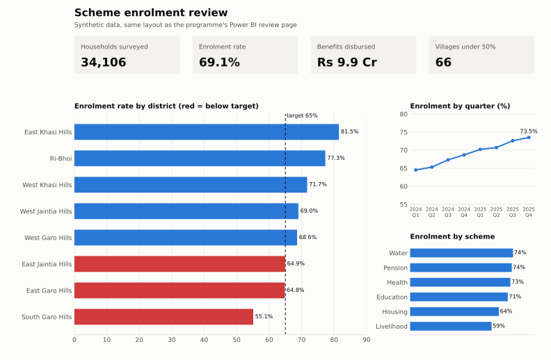
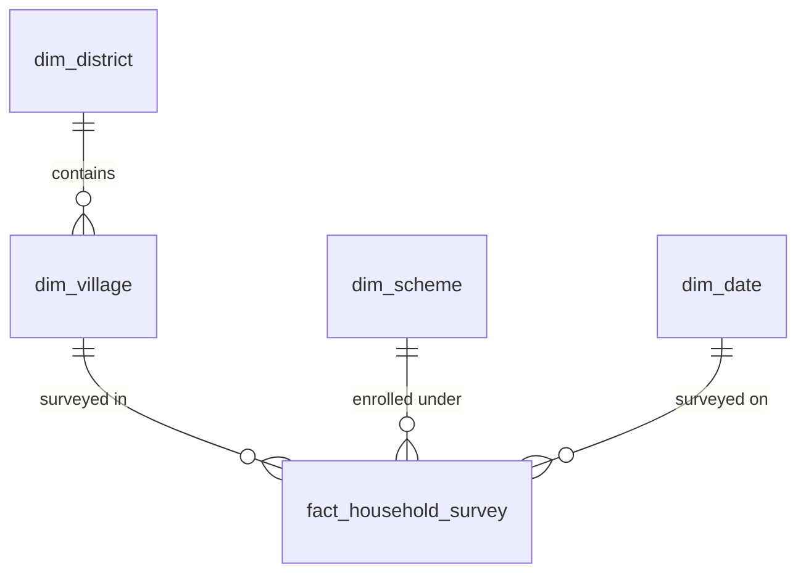

# Programme analytics: star schema, ETL and a KPI dashboard

My main project at ViewZen Labs is analytics for a government programme in Meghalaya. Field teams survey households, and programme officers want to know where enrolment is falling behind and where to send people next. I can't share that data, so this repo rebuilds the same pipeline on made-up numbers.



## How it fits together



It's the same flow I follow at work:

1. `etl_pipeline.py` creates a raw export with the problems real exports have (duplicate rows, blank or lower-case Y/N flags, negative benefit amounts), cleans it and loads it into SQLite.
2. `schema.sql` is the star schema. One fact table of survey records, with district, village, scheme and date dimensions around it.
3. `kpi_queries.sql` has the four KPIs the officers asked for. CTEs and window functions (`LAG`, `RANK`, `SUM() OVER`).
4. `dashboard.py` draws the page above straight from the database.

[docs/requirements.md](docs/requirements.md) is a short version of the requirement doc I'd write before building any of this: who uses the page, what each KPI means exactly, the data checks, and what had to be true before sign-off.

## Running it

```bash
pip install -r requirements.txt
python etl_pipeline.py
python dashboard.py
```

The ETL prints what it threw away on every run:

```
Rows: raw=60,300 -> clean=57,362  (duplicates 300, blank enrolment flag 2398, negative benefit 240)
```

## What the numbers say

All synthetic, but this is how I'd read the page in a review:

- Overall enrolment is 69.1% against a 65% target.
- Three districts are under target. South Garo Hills is the real problem at 55.1%, and all five of the weakest villages are in it, so that's where the field teams should go first.
- Enrolment went up every quarter, from 64.5% in Q1 2024 to 73.5% in Q4 2025.
- Livelihood (59%) and housing (64%) schemes trail everything else, which is worth raising with the scheme owners.

## Notes

At work this page is in Power BI, with row-level security so each district officer only sees their own district. Here it's matplotlib so the repo runs on any machine without a licence. `kpi_queries.sql` is plain SQL and runs on PostgreSQL unchanged.

District names are real. Villages, households and every figure are made up.
